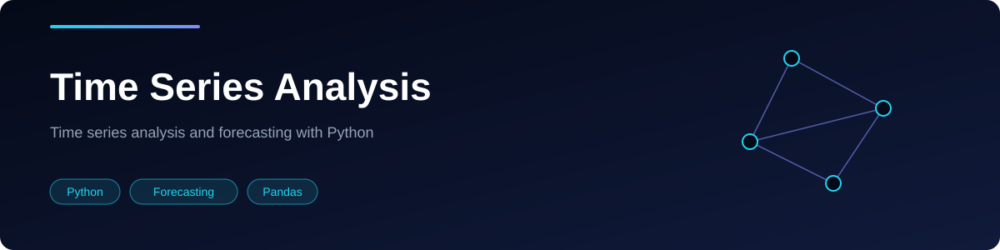

<p align="center"></p>

# Time Series Analysis

Time series analysis and forecasting with Python.

## Problem
<!-- 2-3 lines: kaunsa masla hal kiya gaya hai -->

## Dataset
<!-- Dataset ka naam aur rows/columns kitne hain -->

## Tools
Python · Forecasting · Pandas

## Approach
1. Data load aur cleaning
2. Exploratory analysis
3. Model / analysis
4. Evaluation

## Result
<!-- Asal number likho, jaise Accuracy: __% -->

## How to run
```
pip install -r requirements.txt
jupyter notebook
```

## Author
Muhammad Adil · AI & Data Science, SZABIST ZABTech, Karachi
[GitHub](https://github.com/adilkhattak42201-del)
